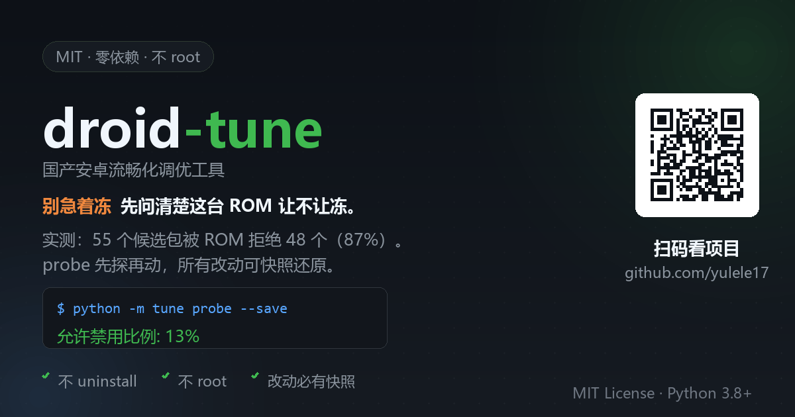

# droid-tune



**不 root 的国产安卓流畅化调优工具。** 零 Python 依赖，所有改动可一键还原。

> 一句话立场：**别急着冻 —— 先问清楚这台 ROM 让不让冻。**

## 为什么还要做一个

这件事的起因是一次失败。

一台 Redmi Note 13 Pro（国行 HyperOS 3），按 UAD 官方清单交叉筛选出 55 个建议冻结的预装包，
逐个执行全网教程推荐的 `pm disable-user --user 0`，结果是：

```
成功冻结 7 个
系统拒绝 48 个  → SecurityException: Cannot disable system packages
失败率 87%
```

**这台 ROM 把绝大多数自家预装锁成了「不可禁用系统核心包」。**
也就是说，那条被所有 debloat 教程默认可行的路线，在这台机器上基本不成立。

更麻烦的是：**没有任何工具会提前告诉你这件事**。它们只会照着清单往下跑，
跑完甩给你 48 行红色报错，让你自己去猜到底是命令写错了、还是机器本来就不行。

所以本项目把顺序倒过来：**动手之前，先用最小的代价测一次可行性。**
`probe` 命令挑少量候选包逐个 `disable → 立刻 enable 恢复`（可逆、无副作用），
据此算出这台 ROM 允许禁用的比例，然后再决定走哪条路。

## 它和其它工具的分工

| 工具 | 主做什么 | 不管什么 |
|---|---|---|
| [UAD-ng](https://github.com/Universal-Debloater-Alliance/universal-android-debloater-next-generation) | 维护按品牌分类的 debloat 清单 + 图形界面 | 默认 assume disable 路线可行，不预警 ROM 层面的拒绝 |
| [android-ad-cleaner](https://github.com/rddmwmddr/android-ad-cleaner) | uiautomator2 模拟点设置开关，去系统广告/热搜/营销推送 | 不做流畅度调优，不做预装冻结 |
| **droid-tune** | **先 probe 可行性再定路线** + 流畅调优 + 带本地保护层的冻结 | 不做 UI 自动化；该用 uiautomator2 时明确推荐你搭配上面两个 |

它们不冲突：底层都是 adb，装几个都行。**去系统广告用 android-ad-cleaner，
要流畅和清理预装用 droid-tune，需要图形界面勾选用 UAD-ng。**

## 三条硬承诺

1. **不 uninstall。** 只用 `pm disable-user`（冻结），永远不卸载。卸载在国行 ROM 上大概率同样被拒，即使成功也难以恢复。
2. **不 root。** 只用 adb 能改的东西。真正的 CPU 调度、温控、IO 调优不在射程范围内。
3. **改动必有快照。** 会修改设备的命令都会先存一份 JSON 快照，`restore` 可一键回退。

## 快速开始

### 前置（一次性）

1. 装 [官方 platform-tools](https://developer.android.com/tools/releases/platform-tools)，保证 `adb version` 能用。
2. 手机开**开发者选项** → 打开 **USB 调试**。
3. **再打开「USB 调试（安全设置）」** —— 这是独立于「USB 调试」的另一个开关，不开的话 adb 能看不能点（详见 [docs/06-踩坑实录.md](docs/06-踩坑实录.md)）。
4. 数据线连电脑，手机上点「允许调试」，保持解锁亮屏。

> ⚠️ 别用 adbutils / python-adb 自带的 adb.exe 糊弄这一步，Windows 下它缺 DLL，
> 执行会直接退出 127 且**没有任何输出**，是个纯浪费时间的排查黑洞。

### 安装

```bash
git clone https://github.com/yulele17/droid-tune.git
cd droid-tune
python -m tune devices     # 零依赖，不需要 pip install
```

Python 3.8+，只用标准库。

## 用法一：让 AI 智能体替你跑（推荐）

把手机按上面连好，然后对你的 AI 助手说：

> 读一下 droid-tune/AGENTS.md，按里面的流程帮我优化这台手机。

项目里带了 [AGENTS.md](AGENTS.md)，规定了 AI 智能体必须遵守的操作流程
（哪些必须先问、哪些绝对不能做、什么情况应该原样保留）。你只负责连线，剩下的它来。

## 用法二：命令行自己跑

建议顺序：

```bash
python -m tune devices              # 1. 确认连上了
python -m tune detect               # 2. 看机型和 ROM 版本
python -m tune probe --save         # 3. ★ 测这台 ROM 让不让禁用包
python -m tune smooth --scale 0.5 --bg-limit 3   # 4. 流畅调优
python -m tune plan --export 清单.md            # 5. 生成冻结候选清单（只读）
#     ← 人工划掉不想冻的
python -m tune freeze --dry-run     # 6. 先看看要冻哪些
python -m tune freeze               # 7. 执行（被 ROM 拒绝属正常）
python -m tune finish               # 8. 收尾，建议关开发者模式
```

### 命令一览

| 命令 | 作用 | 会改设备吗 |
|---|---|---|
| `devices` | 列出设备并处理未授权提示 | 否 |
| `detect` | 机型/ROM 版本识别 | 否 |
| `probe` | ★ 可行性探测，输出「允许禁用比例」和路线建议 | 否（toggle 后立即恢复） |
| `smooth` | 动画缩放、后台进程限制 | 是（有快照） |
| `memory` | 探测「内存扩展」开关 | 否（刻意不自动改） |
| `plan` | 生成冻结候选清单 | 否 |
| `freeze` | 执行冻结 | 是（有快照） |
| `unfreeze` | 解冻 | 是 |
| `snapshot` | 列出快照 | 否 |
| `restore` | 按快照还原 | 是 |
| `finish` | 还原防锁屏 / 关开发者模式 | 是 |

## `probe` 长什么样

```
——————————————————————————————————————————————————
可行性探测结论
——————————————————————————————————————————————————
设备        : Redmi Note 13 Pro（1a43****）
ROM         : OS3.0.306.0.WNRCNXM   家族: xiaomi
样本        : 共 6 个探针包
结果        : 可禁用 1 / 系统锁死 5 / 未安装 0
允许禁用比例: 17%   锁死比例: 83%
结论        : debloat 路线基本不可行
建议        : ROM 把目标包锁成了不可禁用系统核心包，pm disable-user 对它们无效。
              **不要**指望 debloat 工具解决，改走 uiautomator2 模拟点击设置开关的路线…
——————————————————————————————————————————————————
```

看到这个输出，你就知道该省下后面那 48 次尝试了。

## 实测数据

欢迎提 PR 补充你的机型，`probe --save` 生成的报告可直接贴进 `docs/实测/`。

| 机型 | ROM | 允许禁用比例 | 结论 |
|---|---|---|---|
| Redmi Note 13 Pro (2312DRA50C) | HyperOS 3 / OS3.0.306.0.WNRCNXM | ~13% | 基本不可行，建议改走 UI 路线 |

详见 [docs/实测/红米Note13Pro-HyperOS3.md](docs/实测/红米Note13Pro-HyperOS3.md)。

## 明确不做的事（反面清单）

网上流传很广，但收益不明显或副作用常见，本项目不提供：

| 项目 | 为什么不推荐 |
|---|---|
| 关闭「MIUI 优化」 | 容易让状态栏、通知、权限弹窗异常 |
| 强制 GPU 渲染 | 新机型收益微乎其微，可能更耗电、偶发闪退 |
| 停用 HW 叠加层 | 同上，部分机型直接黑屏 |
| 禁用系统更新 | 能防后台偷更，但会漏安全补丁 |
| `pm uninstall -k --user 0` | 卸载当前用户听起来更彻底，但恢复极难，收益率远低于风险 |

真正的性能底层调优（CPU 调度、温控、IO）必须 root 或换内核，**不 root 到这里就是天花板**。
好在近几年的中端机本身不弱，把「拖累感」（动画、后台、广告、预装）清掉，日常体验提升已经很明显。

## 免责

本项目只调用 Android 官方 adb 接口，所有操作可逆。但手机环境千差万别：
**请务必先 `probe`、再 `plan` 人工过目清单、修改前确认快照已生成。**
因误冻结某些包导致功能异常等问题，请按 [docs/05-还原.md](docs/05-还原.md) 处理。

## License

MIT
